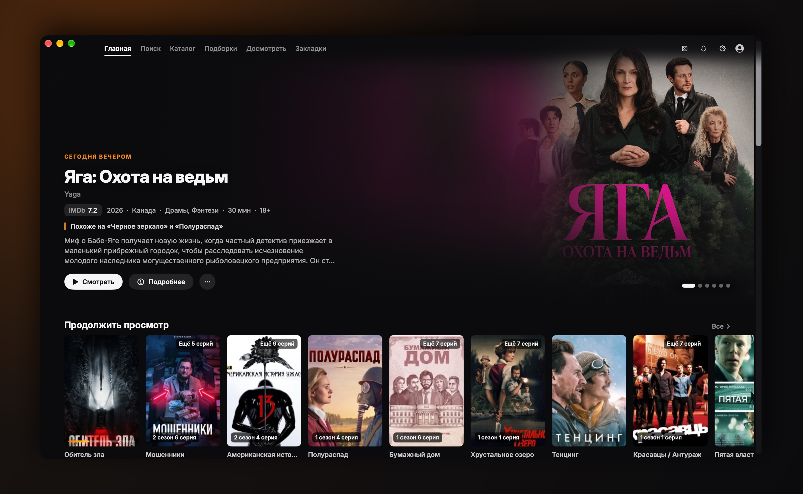
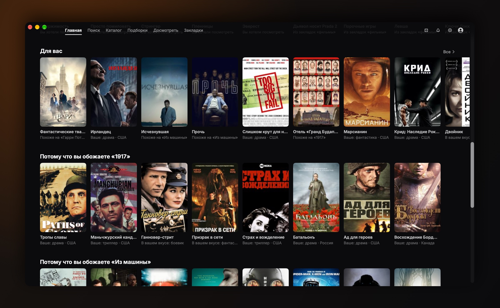
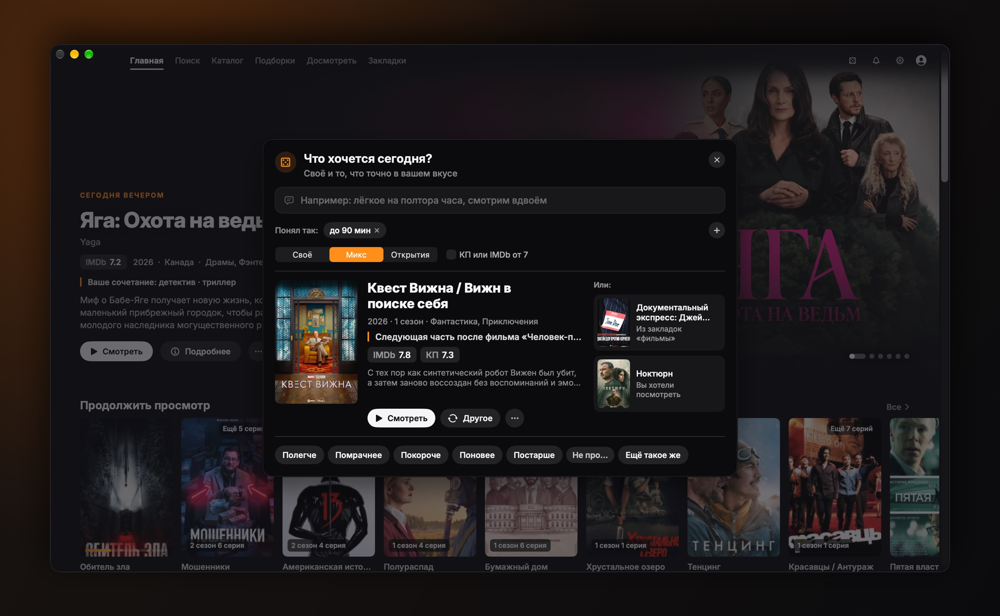
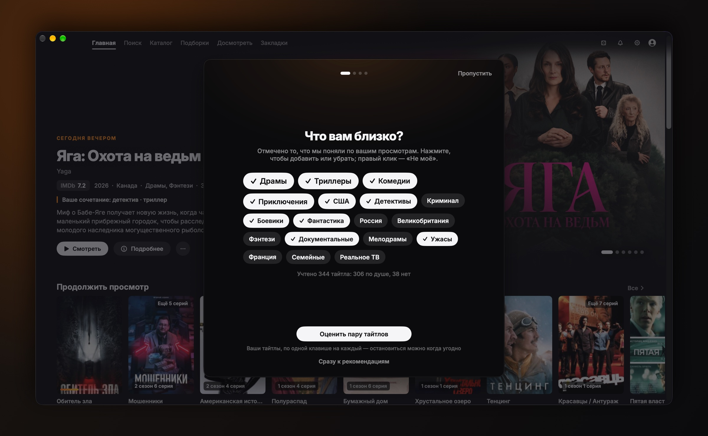
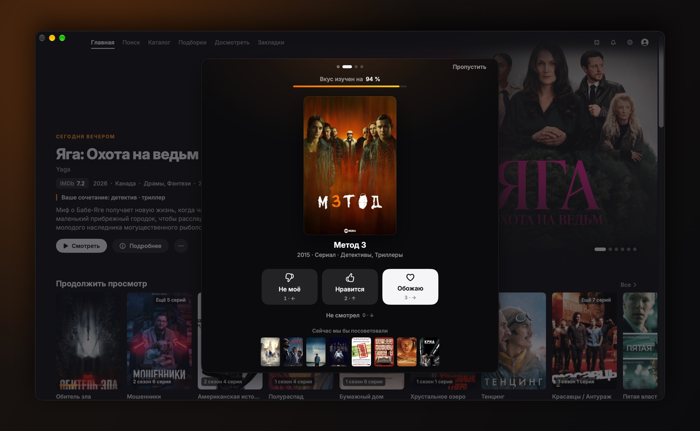
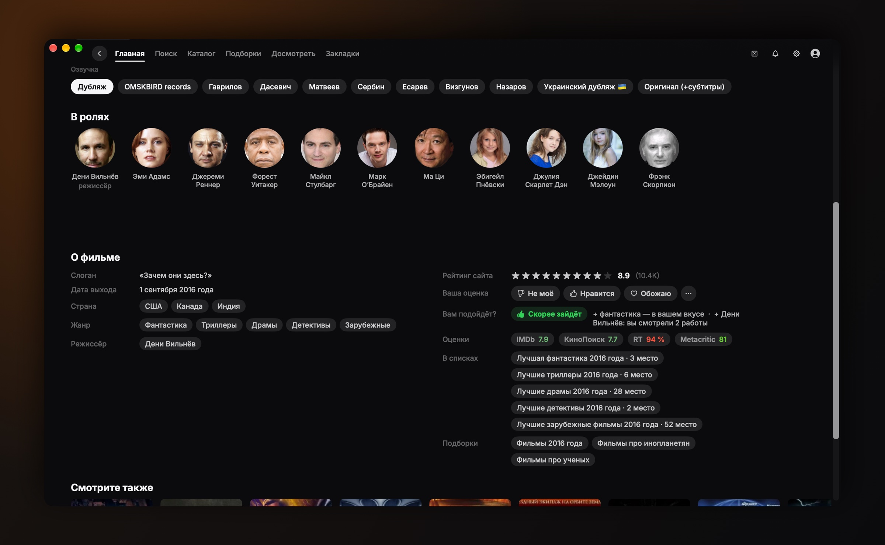
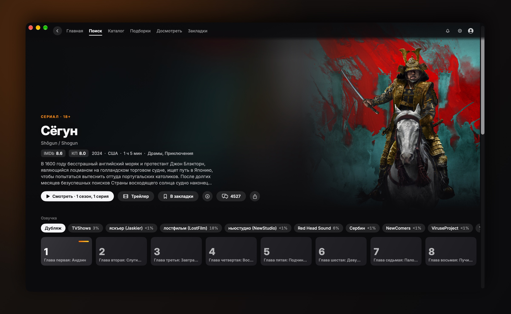
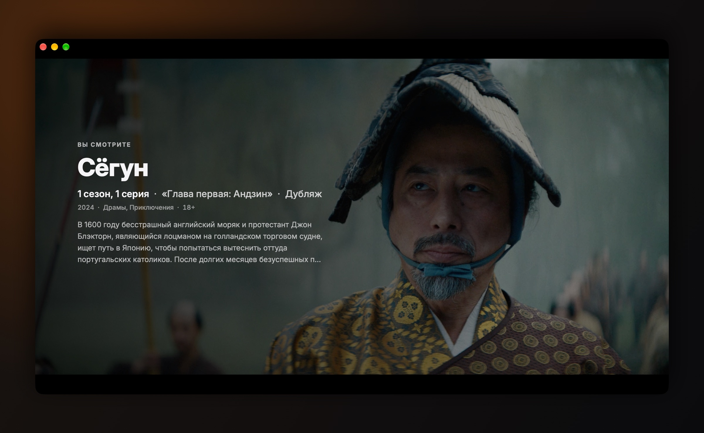
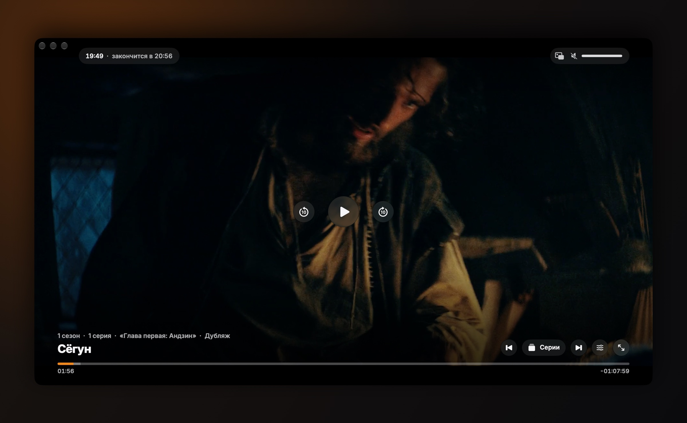

<div align="center">

<picture>
  <source media="(prefers-color-scheme: dark)" srcset="docs/media/wordmark-dark.png">
  
</picture>

### Кино на Mac. Без лишнего.

Нативное приложение онлайн-кинотеатра для macOS: каталог как у больших стримингов, рекомендации, которые объясняют себя, свой плеер с экраном паузы, загрузки и автообновления.<br>
Неофициальное: видео не размещает, адрес сайта вы вводите сами.

[](https://github.com/SashaEee/kinopohuy-macos/releases/latest)
[](https://github.com/SashaEee/kinopohuy-macos/releases)


[](LICENSE)

<br>

[](https://github.com/SashaEee/kinopohuy-macos/releases/latest/download/KinoPohuy.dmg)
&nbsp;
[](https://boosty.to/sanchella_zzz)

<sub>macOS 15 и новее · Apple Silicon и Intel · <a href="#установка">как установить</a> · <a href="https://github.com/SashaEee/kinopohuy-macos/releases">все версии</a></sub>

</div>

<br>

<p align="center">
  
</p>

## Что это

Сайт с фильмами и сериалами, который вы и так открываете в браузере, но в виде настоящего приложения для Mac. Тёмный интерфейс в духе Netflix и Apple TV, собственный плеер вместо веб-плеера, история и закладки из вашего аккаунта на сайте. Приложение берёт страницы сайта, адрес которого вы указали, и показывает их по-своему: ни видео, ни адреса сайта внутри нет.

- **Нативное, а не вкладка браузера.** SwiftUI, плавная прокрутка, клавиатура и медиаклавиши, отдельное окно плеера.
- **Плеер, который приятно ставить на паузу.** Через несколько секунд паузы появляются название, серия, озвучка и описание, как на большом стриминге.
- **Всё в один клик.** «Продолжить просмотр» открывает плеер сразу с того места, где вы остановились.
- **Само подберёт, что посмотреть.** «Сегодня вечером» на главной, ряды «Для вас» и «Выбери за меня» по <kbd>⌘</kbd> <kbd>J</kbd>: по тому, что вы смотрите и как оцениваете, по сюжету и по вкусам похожих зрителей. Каждый совет говорит, почему он здесь, и считается на вашем Mac. <sup>с версии 2.1</sup>
- **Ни телеметрии, ни трекеров.** Открытый код. Приложение можно собрать самому одной командой.

## Как это выглядит

<p align="center">
  
  <br><sub><b>Личные ряды</b> <sup>с версии 2.1</sup>. «Для вас» и «Потому что вы обожаете «…»»: под каждым постером написано, почему он здесь.</sub>
</p>

<p align="center">
  
  <br><sub><b>«Выбери за меня»</b> (<kbd>⌘</kbd> <kbd>J</kbd>) <sup>с версии 2.1</sup>. Готовый вариант сразу, ещё два «Или», а пожелания можно сказать словами.</sub>
</p>

<p align="center">
  
  
  <br><sub><b>«Уточнить вкус»</b> <sup>с версии 2.1</sup>. Что вам близко, потом свои же тайтлы одной клавишей. Внизу видно, как от каждого ответа меняются советы.</sub>
</p>

<p align="center">
  
  <br><sub><b>Оценки и «Вам подойдёт?»</b> <sup>с версии 2.1</sup>. Rotten Tomatoes и Metacritic рядом с IMDb и Кинопоиском, ответ своими словами и ваша оценка в один клик.</sub>
</p>

<p align="center">
  
  <br><sub><b>Страница сериала.</b> Озвучки с долей зрителей, серии плитками, продолжение с нужной минуты.</sub>
</p>

<p align="center">
  
  
  <br><sub><b>Экран паузы и плеер.</b> Смена серии и озвучки без выхода, «закончится в 20:56», картинка в картинке.</sub>
</p>

## Возможности

<table>
<tr>
<td width="50%" valign="top">

**Главная и каталог**
- Большая заставка с трендами, а с версии 2.1 сначала подобранное для вас на этот вечер.
- «Продолжить просмотр»: где вы остановились, а для начатого на этом Mac — полоска прогресса и «Осталось N мин».
- «Новые серии» по вашим сериалам и ряд «Похоже на…».
- Каталог с фильтрами, подборки, поиск по мере набора.
- Закладки и «Досмотреть» из аккаунта на сайте.

</td>
<td width="50%" valign="top">

**Страница фильма или сериала**
- Озвучки прямо на странице, с долей зрителей и пометками сайта.
- Сезоны и серии плитками: просмотренные отмечены, у начатых прогресс.
- «Продолжить с 12:34» или «С начала», время окончания фильма.
- Расписание серий, трейлеры, актёры, комментарии.
- Оценки IMDb и Кинопоиска, а с версии 2.1 ещё Rotten Tomatoes и Metacritic.

</td>
</tr>
<tr>
<td width="50%" valign="top">

**Плеер**
- Экран паузы: сезон, серия и её название, озвучка и описание фильма или сериала.
- Смена озвучки и серии на лету, следующая серия с отсчётом.
- Картинка в картинке, AirPlay, пространственное аудио, субтитры, качество, таймер сна.
- Стеклянные кнопки Liquid Glass на macOS 26 и новее.
- Пробел, стрелки, <kbd>F</kbd>, <kbd>M</kbd>, медиаклавиши. Или откройте во внешнем плеере: IINA, Infuse, mpv, VLC.

</td>
<td width="50%" valign="top">

**Остальное**
- Загрузки для офлайна через встроенный aria2: до 10 сразу, ход виден в строке меню.
- Компактная раскладка для MacBook Air и Pro 14″: первый ряд постеров виден сразу.
- Мастер первого запуска и настройки (<kbd>⌘</kbd> <kbd>,</kbd>).
- Автообновление через Sparkle, каждое обновление проверяется подписью.
- Приложение обращается только к сайту, адрес которого вы указали (и к серверам, с которых он отдаёт видео и картинки), к GitHub (лента и файлы обновлений) и к Rutube за трейлерами. Данные для рекомендаций лежат внутри приложения.

</td>
</tr>
<tr>
<td width="50%" valign="top">

**Рекомендации** <sup>с версии 2.1</sup>
- Заставка «Сегодня вечером» и ряды «Для вас», «Потому что вы смотрите «…»», «Подборки для вас», «Можно начать».
- Советы по связям сайта, жанрам и людям, по сюжету (описания сравнивает встроенная в macOS языковая модель) и по вкусам зрителей с похожими оценками.
- У каждого совета причина и «Почему это?» с кнопками «Меньше такого» и «Не учитывать».
- «Не моё», «Нравится», «Обожаю» на странице и правым кликом по постеру. Оценённый фильм считается просмотренным: уходит из «Продолжить просмотр» и отмечается на сайте.
- «Уточнить вкус» за минуту: что вам близко, пара своих тайтлов, «Что хочется посмотреть?». Советы меняются на глазах.
- «Вам подойдёт?» на странице тайтла: «Скорее зайдёт», «50 на 50» или «Скорее нет», и почему.
- Импорт оценок из IMDb и Letterboxd (CSV).

</td>
<td width="50%" valign="top">

**«Выбери за меня»** (<kbd>⌘</kbd> <kbd>J</kbd>) <sup>с версии 2.1</sup>
- Готовый вариант сразу, с учётом дня недели и времени, и ещё два «Или».
- Скажите словами (<kbd>⌘</kbd> <kbd>K</kbd>): «лёгкое на полтора часа, смотрим вдвоём», «как «Мост», но короче», «без ужасов».
- «Полегче», «Помрачнее», «Покороче», «Поновее» поправят выбор, «Другое» покажет следующий.
- Если ровно такого нет, скажет, какое условие ослабило.

</td>
</tr>
</table>

## Установка

1. Скачайте [**KinoPohuy.dmg**](https://github.com/SashaEee/kinopohuy-macos/releases/latest/download/KinoPohuy.dmg) из последнего релиза.
2. Откройте его и перетащите «КиноПохуй» в «Программы».
3. Запустите приложение. macOS скажет, что не может проверить разработчика: нажмите «Готово».
4. Откройте **Системные настройки → Конфиденциальность и безопасность**, прокрутите вниз и нажмите **«Всё равно открыть»** рядом с «КиноПохуй», затем подтвердите паролем.

Это нужно один раз. Начиная с macOS 15 старый способ «Ctrl‑клик → Открыть» больше не работает. То же самое одной командой в Терминале:

```bash
xattr -dr com.apple.quarantine "/Applications/КиноПохуй.app"
```

> [!NOTE]
> Почему так: приложение подписано без платного сертификата Apple Developer ID, поэтому macOS не может его проверить. Код открыт, а суммы SHA-256 каждого релиза лежат в `SHA256SUMS.txt` рядом с файлами. Сертификат — первая цель [донатов](#поддержать-проект).

**Обновления** приходят сами: раз в сутки приложение проверяет новую версию и предлагает установить её. Настроить можно в **Настройки → Обновления**.

### Первый запуск

1. Примите условия использования.
2. Введите адрес сайта и нажмите «Проверить». Подойдёт и ссылка на любую страницу сайта: приложение возьмёт из неё адрес само. В приложение адрес не встроен, мы его не публикуем и не храним.
3. По желанию войдите в свой аккаунт на сайте. Тогда появятся закладки, «Продолжить просмотр» и новые серии.

Адрес можно сменить в любой момент: **Настройки → Основное → Сайт**. Премиум оформляется на самом сайте: приложение показывает только то, что доступно вашему аккаунту.

## Вопросы и ответы

<details>
<summary><b>Сколько стоит приложение?</b></summary>

Нисколько: это открытый проект под лицензией MIT. Платных функций в приложении нет и не будет. Условия доступа к фильмам и премиум определяет сам сайт.
</details>

<details>
<summary><b>С каким сайтом оно работает и где взять адрес?</b></summary>

С русскоязычным онлайн-кинотеатром, который мы намеренно не называем. Адрес тоже не публикуем и не встраиваем: его вводите вы, и он хранится только на вашем Mac.
</details>

<details>
<summary><b>Это безопасно?</b></summary>

Весь код открыт, и приложение можно собрать самому. Аналитики, трекеров и сбора данных нет. Места просмотра и история хранятся на этом Mac; если вы вошли в аккаунт, сайт, как и в браузере, тоже запоминает, что вы смотрели. Логин и пароль уходят только на сайт, приложение хранит лишь cookies сессии, как браузер.
</details>

<details>
<summary><b>Как работают рекомендации и что они о вас знают?</b></summary>

Всё считается на этом Mac, на серверы проекта ничего не уходит (их и нет). Вкус складывается из «Досмотреть» в аккаунте, истории просмотров на этом Mac, ваших оценок и, если хотите, импорта из IMDb или Letterboxd. Советы приходят из нескольких источников:
- связи на сайте («Смотрите также», списки, подборки, франшизы);
- жанры, страны, режиссёры и актёры, которые вам нравятся;
- похожие по сюжету (описания сравнивает встроенная в macOS языковая модель);
- что нравится зрителям с похожими вкусами;
- оценки критиков из Викиданных.

Чтобы знать о фильмах больше, чем видно в рядах, приложение в фоне читает страницы сайта под вашим аккаунтом: по одной, не чаще раза в 3 секунды и не больше 300 в день. Сайт видит эти открытия так же, как если бы вы листали сами. Лимит меняется или выключается в Настройках → «Рекомендации»; там же «Сбросить вкус», «Очистить данные рекомендаций» и «Экспорт…».
</details>

<details>
<summary><b>Почему macOS ругается при первом запуске?</b></summary>

У приложения нет платного сертификата Apple Developer ID и нотаризации. Один раз разрешите запуск, как описано в разделе <a href="#установка">«Установка»</a>. Донаты помогут купить сертификат, чтобы приложение открывалось без этого шага.
</details>

<details>
<summary><b>Как обновляться?</b></summary>

Никак, приложение обновится само: Sparkle предложит новую версию и установит её после перезапуска. Если идут загрузки, приложение спросит и по умолчанию подождёт, пока они закончатся. Проверить вручную можно в меню «КиноПохуй» → «Проверить наличие обновлений…». Если после обновления macOS переспросит, открывать ли приложение, нажмите «Открыть»: настройки и история останутся.
</details>

<details>
<summary><b>Почему не в App Store?</b></summary>

Клиент стороннего сайта с видео не пройдёт проверку App Store, а GitHub оставляет код открытым.
</details>

<details>
<summary><b>Будут ли версии для телевизора, iPad или Windows?</b></summary>

Версия для телевизоров Samsung в работе. Чтобы не пропустить, нажмите <b>Watch → Custom → Releases</b> вверху этой страницы. Планов на iPad и Windows пока нет.
</details>

<details>
<summary><b>Куда писать о багах и идеях?</b></summary>

В <a href="https://github.com/SashaEee/kinopohuy-macos/issues/new/choose">Issues</a>: там есть формы «Ошибка» и «Идея». Перед отправкой уберите из скриншотов и логов адрес сайта.
</details>

## Поддержать проект

«КиноПохуй» делается в свободное время. Если он вам нравится, поддержите разработку. Донат — это спасибо, а не плата: все функции доступны всем.

**Первая цель — сертификат Apple Developer ID** ($99 в год): с ним приложение будет открываться сразу, без «Всё равно открыть» в настройках. Дальше — новые функции и версия для телевизоров.

<table>
<tr>
<td valign="middle">

**Boosty** — картой российского банка, разово или подпиской:

[](https://boosty.to/sanchella_zzz)

**USDT в сети TON** — из Telegram Wallet или любого TON-кошелька:

```text
UQC3PZ6C2Bhte2-pvdbT9a5c54tSNynDcz080vKHJ3UB8i2f
```

> **Только USDT в сети TON.** Другие монеты и сети (TRC-20, ERC-20) на этот адрес не дойдут.

</td>
<td width="190" align="center" valign="middle">
<br>
<sub>USDT · TON</sub>
</td>
</tr>
</table>

То же самое есть в приложении: **Настройки → О программе → Поддержать проект**.

**Звезда на GitHub — тоже поддержка:** так проект находят другие.

## Сборка из исходников

Для сборки нужны macOS 15.6 или новее и Xcode 26 или новее (проверено на Xcode 27.2); готовое приложение работает на macOS 15 и новее. Аккаунт разработчика Apple не нужен.

```bash
git clone https://github.com/SashaEee/kinopohuy-macos.git
cd kinopohuy-macos
./build-mac.sh    # соберёт Release для этого Mac и установит /Applications/КиноПохуй.app
```

Пакет открытых данных для рекомендаций (оценки критиков, связи фильмов) собирается скриптами из [`scripts/datapack`](scripts/datapack); без него приложение работает, только без этих оценок и советов зрителей. Движок рекомендаций — отдельный Swift-пакет [`RecommenderCore`](RecommenderCore) с тестами (`swift test`).

Или откройте `VideoLib.xcodeproj` в Xcode, выберите схему `VideoLib` и нажмите Run. `VideoLib` — внутреннее имя проекта, приложение называется «КиноПохуй». Как устроен код и как прислать изменения — в [CONTRIBUTING.md](CONTRIBUTING.md).

## Отказ от ответственности

- «КиноПохуй» — неофициальное приложение. Оно **не связано** с сайтом, его владельцами и правообладателями.
- У проекта **нет своих серверов**: приложение ничего не размещает и не распространяет. Оно показывает страницы сайта, которые вы открываете сами, так же как браузер, а загрузки для офлайна сохраняются только на вашем Mac.
- **Адрес сайта указываете вы.** В приложении и в этом репозитории его нет.
- Премиум оформляется на самом сайте: приложение показывает только то, что доступно вашему аккаунту.
- Соблюдайте **законы своей страны** и правила сайта.
- Приложение предоставляется **«как есть»**, без каких-либо гарантий (см. [LICENSE](LICENSE)).

Правообладателям: как связаться, написано в [SECURITY.md](SECURITY.md#правообладателям). Мы отвечаем быстро.

## Благодарности и лицензии

- Код «КиноПохуй» распространяется под лицензией [MIT](LICENSE).
- Проект вырос из открытого кода voidboost (MIT, © 2025 voidboost). Спасибо автору: его уведомление об авторских правах сохранено в [LICENSE](LICENSE).
- [aria2](https://github.com/aria2/aria2) 1.37.0 — встроенный загрузчик, GNU GPL v2 или новее. Собран из официального архива скриптом [`scripts/aria2/build.sh`](scripts/aria2/build.sh); архив с исходниками приложен к каждому релизу.
- [Inter](https://github.com/rsms/inter) — шрифт интерфейса, SIL Open Font License 1.1.
- [Викиданные](https://www.wikidata.org) — оценки Rotten Tomatoes и Metacritic, соответствия IMDb и Кинопоиска (CC0), выгружены через [QLever](https://qlever.dev) Фрайбургского университета.
- Пакеты Swift: [The Composable Architecture](https://github.com/pointfreeco/swift-composable-architecture) и другие библиотеки Point-Free, [Alamofire](https://github.com/Alamofire/Alamofire), [Kingfisher](https://github.com/onevcat/Kingfisher), [GRDB](https://github.com/groue/GRDB.swift), [SQLiteData](https://github.com/pointfreeco/sqlite-data), [Sparkle](https://github.com/sparkle-project/Sparkle), [SwiftSoup](https://github.com/scinfu/SwiftSoup), [Pow](https://github.com/EmergeTools/Pow), [Defaults](https://github.com/sindresorhus/Defaults), [SwiftUI-Flow](https://github.com/tevelee/SwiftUI-Flow), [LRUCache](https://github.com/nicklockwood/LRUCache), [Swift Collections](https://github.com/apple/swift-collections), [Swift Algorithms](https://github.com/apple/swift-algorithms).

Полный список с версиями и текстами лицензий — в [THIRD_PARTY_NOTICES.md](THIRD_PARTY_NOTICES.md) и в самом приложении: **О программе → Лицензии**.

---

## English

**KinoPohuy** is a native macOS client (SwiftUI) for a Russian-language online cinema: a streaming-style catalog, on-device recommendations that explain themselves (site links, plot similarity via macOS's built-in language model, taste-alike viewers, critics' scores from Wikidata; a «pick for me» that understands plain Russian; since 2.1), its own player with a Netflix-like pause screen, picture-in-picture and AirPlay, offline downloads via aria2, Sparkle auto-updates and no telemetry. It is unofficial and hosts or distributes nothing: you enter the site address yourself. The interface is in Russian.

macOS 15+, Apple Silicon and Intel. [Download the DMG](https://github.com/SashaEee/kinopohuy-macos/releases/latest/download/KinoPohuy.dmg). The app isn't notarized, so on first launch open System Settings → Privacy & Security → **Open Anyway**. Support the project on [Boosty](https://boosty.to/sanchella_zzz) or with USDT on TON (address above). MIT-licensed, based on open-source code by voidboost (MIT, © 2025 voidboost).
